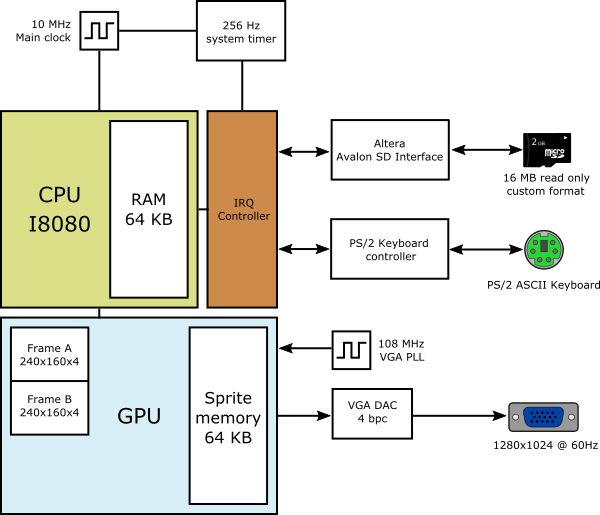

# XCM2 Fridge

Fridge is an 8-bit computer based on an extended Intel 8080 instruction set with graphics acceleration. It includes an emulator, FPGA designs for Digilent Atlys (Spartan-6) and Terasic DE0-CV (Cyclone V), an assembly compiler, a simple language compiler and an IDE.

## Current progress
| Component | State |
| - | - |
| Win64 emulator | Done
| WebAssembly emulator | To do
| Spartan-6 Atlys VHDL | Active: TEXT and programmable palette verified on hardware
| DE0-CV VHDL | On hold
| Assembly compiler | Done
| Frion compiler | In progress
| Fridge IDE | On hold

## Spartan-6 Atlys target

The board build is part of this repository at
[`fpga/fridge_spartan6`](fpga/fridge_spartan6/README.md), on branch
`spartan6-atlys`. It uses ISE 14.7 in Docker and Digilent Adept for programming.
The CPU runs at 10 MHz, with 64 KB BRAM RAM, 240x160 graphics and 40x20 TEXT
mode scaled to 720p60 HDMI. ROM, keyboard and programmable palette demos are
included. The shared `falc/` assembler and `x2al_std/` library generate the
program images; no separate Fridge checkout is needed. The combined system
and interactive demo are documented in
[`INTEGRATION.md`](fpga/fridge_spartan6/INTEGRATION.md); the user verified the
combined demo on the Atlys on 2026-10-07. Advanced framebuffer access and
sprites are implemented in shared RTL; the new
[`graphics` demo](fpga/fridge_spartan6/programs/graphics/README.md) passes
simulation and timing and awaits its board test.

```bash
make -C fpga/fridge_spartan6 regen
make -C fpga/fridge_spartan6 test
make -C fpga/fridge_spartan6 all timing
make -C fpga/fridge_spartan6 load
```

See the [porting plan](fpga/fridge_spartan6/PORTING_PLAN.md) for the implemented
hardware contracts, verification gates and remaining GPU work.

## Block diagram


## System specs

### CPU
* Modified Big-Endian Intel 8080
* Graphical instructions
* 10 MHz clock frequency

### RAM
* 64 KB (16-bit address)

### Video
* Display: 240x160 base mode; optional 210x160 or 240x180
* 4-bit pallette (16 colors) from 4096 possible colors
* Two framebuffers, each 4 bits per pixel (16,800 bytes at 210x160)
* 64 KB sprite memory, in addition to the two framebuffers
* ASCII text mode with a 6x8 font: 35x20 / 40x20 / 40x22 cells

The shared `include/fridge.h` currently selects `FRIDGE_VIDEO_210X160` for the
P4 landscape display. With that selection disabled and no video-mode define,
the base mode is 240x160. Select `FRIDGE_VIDEO_240X180` consistently when compiling
the emulator and assembler to use 240x180. Its four partial bottom rows render
as palette color zero. Video coordinates and the FALC width alias use 8-bit values.

Run the renderer regression tests for the current selection and 240x180:

```bash
cmake -S fridgemulib -B build-video
cmake --build build-video -j
ctest --test-dir build-video --output-on-failure
```

### ROM
* SD card (16 MB maximum)
